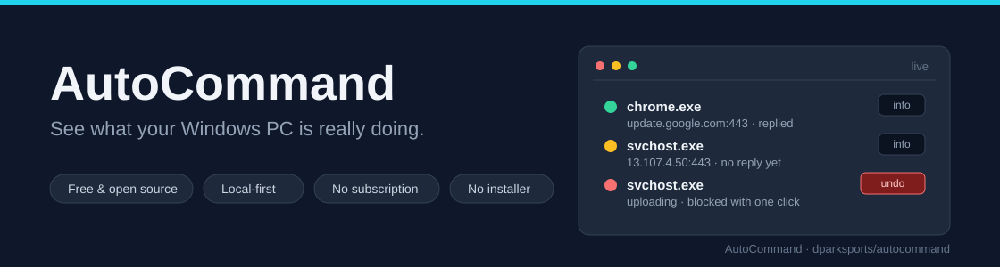
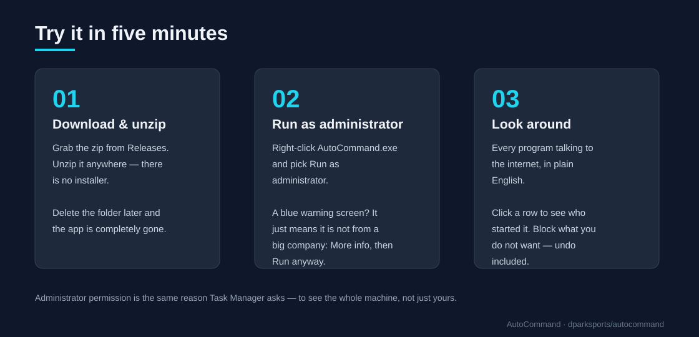
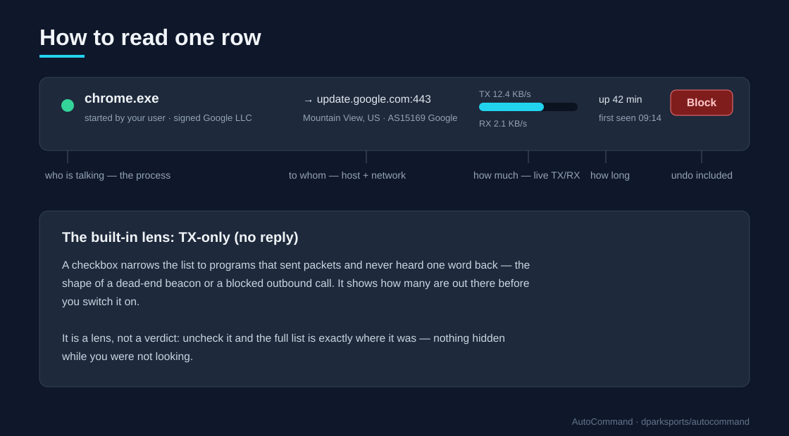
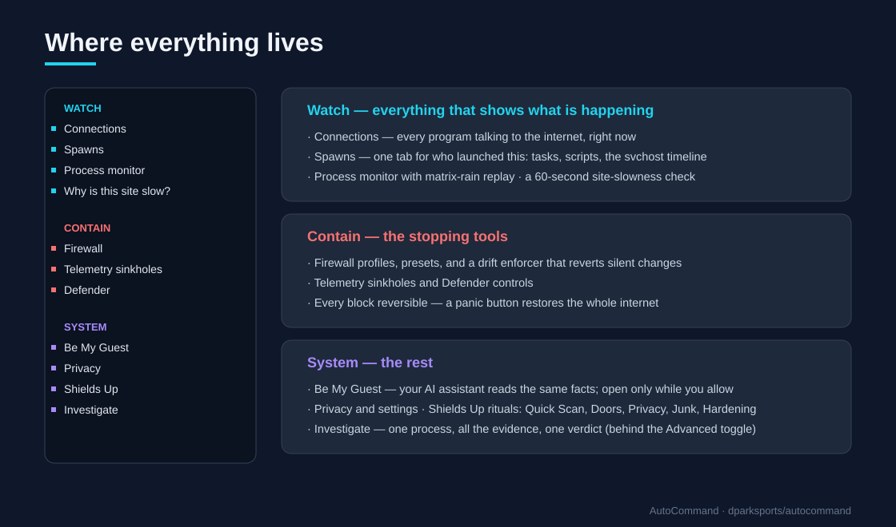
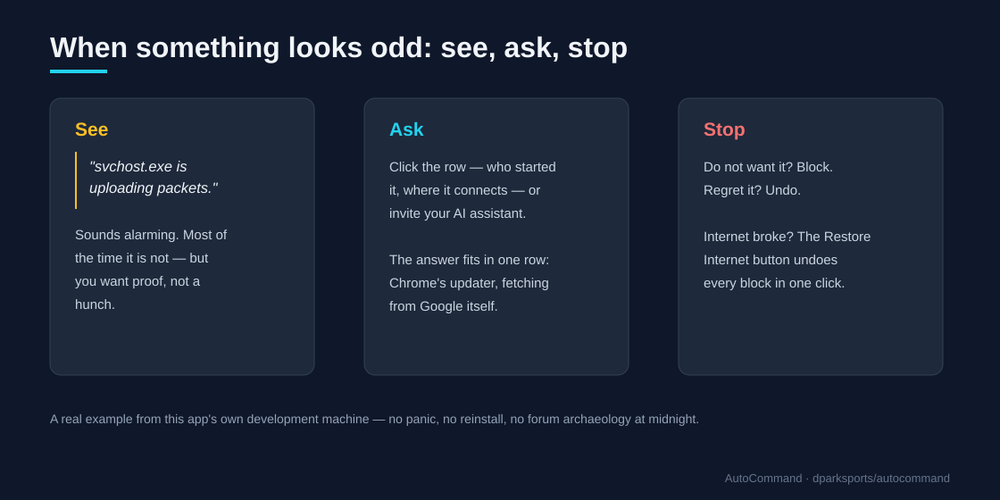
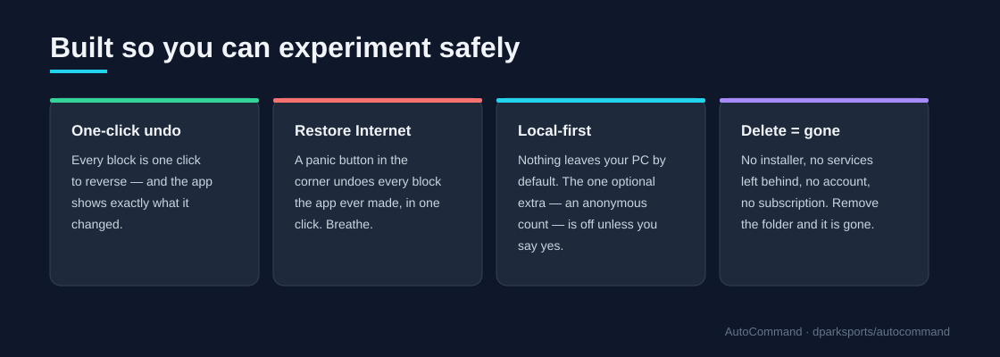
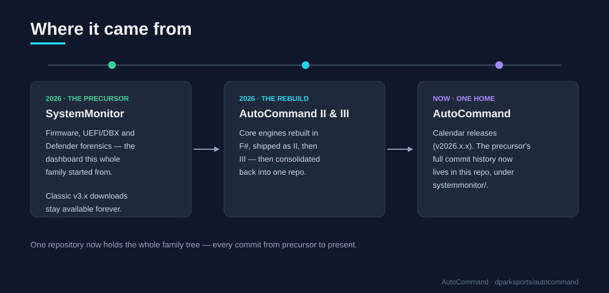

> [!IMPORTANT]
> **This is the classic precursor repo — the app lives on as AutoCommand.**
> The latest version is **AutoCommand v2026.11.2**, published at
> **[dparksports/autocommand → Releases](https://github.com/dparksports/autocommand/releases/latest)**.
> Development, issues, and the full family history all happen there — this repository's
> source is preserved as the classic tree at
> [`autocommand/systemmonitor/`](https://github.com/dparksports/autocommand/tree/master/systemmonitor).
> Classic SystemMonitor v3.x downloads (through v3.15.2) remain on
> [this repo's Releases page](https://github.com/dparksports/SystemMonitor/releases).

<div align="center">
  

  **AutoCommand** — free, open-source Windows visibility, in plain English.

  [](https://github.com/dparksports/autocommand/releases/latest)
  [](LICENSE)
  [](https://github.com/dparksports/autocommand/releases/latest)
</div>

Antivirus matches files against a list of known-bad ones. That is a fine job — but it has nothing to say about the "clean" program phoning home more than it should, and it goes quiet exactly when your computer is acting weird. AutoCommand is the piece antivirus never gives you: **it shows you every program on your PC that talks to the internet, explains each one in plain English, and stops anything you don't want** — one click, undo included. It sends nothing anywhere, costs nothing, and deleting the folder uninstalls it completely.

Keep your antivirus if you like it. They do different jobs. Many people run both.

## Try it in five minutes



1. **Download** `AutoCommand-v…-win-x64.zip` from [Releases](https://github.com/dparksports/autocommand/releases/latest) and unzip it anywhere. There is no installer; every release ships with SHA256 checksums so you can verify what you downloaded.
2. **Right-click `AutoCommand.exe` → Run as administrator.** The same reason Task Manager asks: to see the whole machine, not just your user. Windows may show a blue "protected your PC" screen because the app isn't from a big company — **More info → Run anyway**. It's open source; anyone can read exactly what it does, and that's rather the point.
3. **Look around, ask something.** The first screen lists every program talking to the internet right now. Looking changes nothing.

That's the whole tutorial.

## How to read one row



Every row tells you who's talking, to whom, how much, for how long — and gives you a Block button with an undo, plus a panic button that restores everything. When a row surprises you, *that's* the moment to click it — not before. Most rows, you'll never need to think about.

One question the list answers for itself: the **TX-only (no reply)** checkbox — off by default — narrows the list to programs that *sent* packets and never heard one word back. That's the shape of a blocked outbound call or a dead-end beacon, and the checkbox shows how many are out there before you switch it on. It's a lens, not a verdict: uncheck it and the full list is exactly where it was.

## Where everything lives



The sidebar groups its tools by the question you're asking, not by what they do internally. **Watch** is everything that shows what's happening — including **Spawns**, one tab for "who launched this?": scheduled-task launches, Python programs and the svchost timeline sit side by side. The Process Monitor's right panel replays live process traffic as a Matrix-style digital rain, and either pane folds from the thin rail between them. When a site feels slow, **Why is this site slow?** runs a 60-second check and says what it found in one plain sentence, with the math one click away. **Contain** holds the stopping tools. **System** is the rest: AI access, privacy, settings — and, behind the Advanced-investigation toggle, **Investigate**, which joins everything the app recorded about one process into a single verdict and a copyable report. Watching never stops just because you looked at another screen — a feed runs until you stop it, not until you click away.

## When something looks odd



Real example, from this app's own development machine: *"svchost.exe is uploading packets"* sounds alarming — it turned out to be Chrome's updater downloading from Google's own servers, and AutoCommand proved it in one row. No panic, no reinstall, no forum archaeology at midnight.

## Built so you can experiment safely



Security tools you're afraid to touch are security tools you won't use. Every block is reversible in one click; the 🚑 **Restore Internet** button in the corner undoes every block the app ever made; nothing is sent anywhere by default; and there's no installer to untangle — remove the folder and it's gone.

## Where it came from



This started here — as **SystemMonitor**, a firmware, UEFI/DBX and Defender forensics dashboard. The core engines were later rebuilt in F#, shipped as AutoCommand II and then III, and everything has since been consolidated into the [AutoCommand repository](https://github.com/dparksports/autocommand). This repository's **complete source tree and commit history** are preserved there under [`systemmonitor/`](https://github.com/dparksports/autocommand/tree/master/systemmonitor); the classic v3.x releases remain downloadable on [this repo's Releases page](https://github.com/dparksports/SystemMonitor/releases). One repo now holds the whole family tree.

## Be My Guest — your AI assistant, invited

If you use an AI assistant, the **Be My Guest** tab can invite it to read the same facts the app sees — who launched what, where things connect, what got blocked — through a local bridge on your own machine. **The door is only open while you keep it open**: the access is grant-based, revocable, and every capability it exposes is one the app already performs in front of you. No cloud middleman, no account, nothing to create.

## What it sends about you

**Nothing, by default.** Everything happens on your computer. The one optional extra — an anonymous usage count with no identifiers — exists so the project can show a download graph, and it is off unless you say yes. Details in [PRIVACY.md](https://github.com/dparksports/autocommand/blob/master/PRIVACY.md).

## For developers and tinkerers

The C# WPF shell drives app-agnostic **F# engines** (firewall with strong-typed COM, Sysmon watching, DNS/geo/RDAP, TLS interception, forensics, site diagnosis, the MCP agent bridge). The full story of that rebuild — what moved, what was ported forward — is in [docs/history/README-III.md](https://github.com/dparksports/autocommand/blob/master/docs/history/README-III.md).

```powershell
# .NET 10 SDK required
git clone https://github.com/dparksports/autocommand.git
cd autocommand
dotnet build AutoCommand.csproj -c Release

# self-contained build (what the releases ship)
dotnet publish AutoCommand.csproj -c Release -r win-x64 --self-contained

# offline self-test suites (synthetic inputs, run anywhere)
dotnet run --project ContainSelfTest
dotnet run --project NetWatchSelfTest
dotnet run --project WslSelfTest
```

The precursor tree preserved at [`systemmonitor/`](https://github.com/dparksports/autocommand/tree/master/systemmonitor) is excluded from the app build on purpose. Release automation lives in the [AutoCommand repo's workflows](https://github.com/dparksports/autocommand/tree/master/.github/workflows): every push runs the self-test gate, and a `v20…` tag builds and attaches the release zip with checksums. Bugs and ideas: see [SUPPORT.md](https://github.com/dparksports/autocommand/blob/master/SUPPORT.md); security reports: [SECURITY.md](https://github.com/dparksports/autocommand/blob/master/SECURITY.md) — please use private reporting.

## Common questions

| What you see | What to do |
|---|---|
| "A program I don't recognize is on the list" | Most are normal Windows parts. Double-click the row — it shows who started it and where it connects. Still unsure? Invite your AI assistant to take a look. |
| "It asked for Administrator permission" | That's how it sees system processes, not just yours. It never uses that permission without asking you first. |
| "Should I remove my antivirus?" | Your call — they do different jobs. AutoCommand shows what's happening; antivirus scans files. Many people run both. |
| "What does it send about me?" | Nothing, by default. (The one optional anonymous count is off unless you say yes.) |
| "I blocked something and the internet broke" | Breathe. The 🚑 **Restore Internet** button undoes every block the app made, in one click. |

## License

[Apache-2.0](LICENSE). Free to use, free to read, free to leave.
